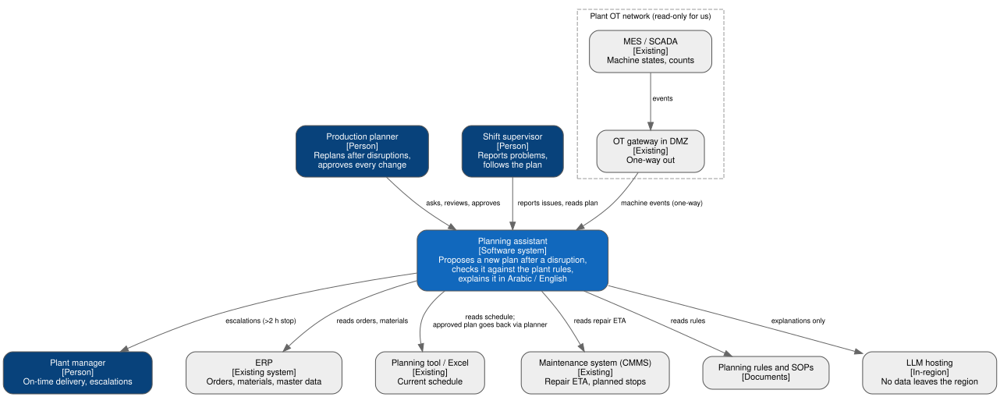
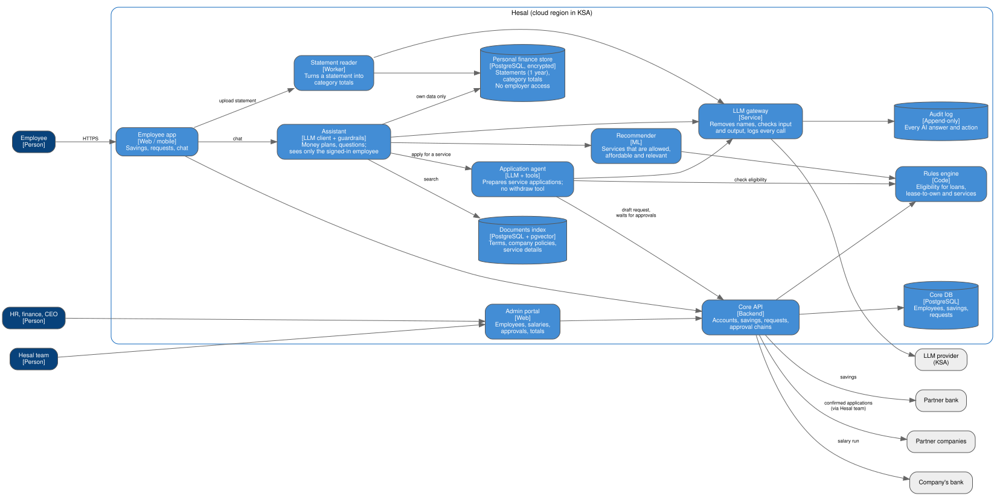

# Session 1 – Architecture views, steps and process

18 Oct 2026 · Eng. Sameh Amin

## Key ideas from the session

The class example was an e-commerce store whose marketing is all manual: fixed home-page offers, discounts added by hand, campaigns sent from the admin panel.

1. **Draw the baseline before the target.** TOGAF frames the work as baseline architecture → target architecture. We drew the store as it is today before adding anything.
2. **The baseline gives the KPIs their reference numbers.** "Raise CSAT from 60% to 80%" only works if the 60% was measured. The baseline also shows what data already exists to build on.
3. **Pain points → goals → non-goals.** Pain points: static offers instead of per-customer or per-segment ones, next-best action for abandoned carts and likely churners, cold start for new users, and campaigns still made by hand (wanted: generated by agentic AI). Goal: CSAT 60% → 80%, measured by ratings and text feedback. Non-goal: lowering refunds.
4. **The funnel is collapsing.** Awareness → interest → search → purchase becomes one moment: the right product, for the right person, at the right time, with "buy now" on the same screen.
5. **Fix what must not change before moving.** Security and compliance first: data stays in-country (in transit and on disk), GDPR, PDPL for PII, AI guardrails against bad output and prompt injection, internal systems behind a VPN, external systems authenticated and on HTTPS.
6. **Write assumptions down, with their source.** 50 concurrent users (from the last 6 months), 100 at seasonal peaks (Ramadan, holidays).
7. **Apply perspectives to views** (Rozanski & Woods). Quality attributes such as security, performance, availability and evolution cut across every view: functional, information, concurrency, development, deployment, operational. Examples: information × security (access control), concurrency × performance (shared resources, blocking, queuing), functional × evolution (extension points, flexible interfaces).
8. **The target adds an AI layer around the existing stores.** RFM, CLV and segmentation models feed customer segments; a churn model runs on a 24-hour ETL; a guardrails service scans customer interactions; the recommendation engine starts with fixed rules and sends abandoned-cart reminders over WhatsApp.

## Applied to the capstone

| Session idea | What it changes in the planning assistant |
|---|---|
| Baseline first | Draw today's replanning flow before the target: planner, ERP, MES, maintenance system, planning rules, and the phone calls in between. Still to draw: `diagrams/src/baseline.dot`. |
| Baseline numbers | The KPI is replanning time: 30–90 min by hand today (see README). Still to write: the target number, and how it's timed (disruption reported → plan approved). |
| Goals / non-goals | Two non-goals are already in the repo: the assistant never writes to machines (OT is one-way), and the LLM never builds the schedule (ADR 0002). |
| Fix what must not change | Already fixed: data stays in the region, OT is read-only, a human approves every change. Add from this session: guardrails on what the LLM reads and says, internal services behind a VPN, auth + HTTPS on anything external. |
| Assumptions with a source | Write load the same way: planners per plant, disruptions per day, and the seasonal peak (Ramadan for a food and beverage maker). Mark each as made-up until it has a source. |
| Perspectives × views | The cells that matter most here: information × security (who sees which plant's data), concurrency × performance (several disruptions at once → solver queue), operational × availability (LLM down → plans still flow, per ADR 0002). |
| Target in steps | v1 keeps the plant systems as read-only sources and adds solver + checker + LLM explainer around them, like the class example. |

## Decisions this triggers

- **ADR 0003** – Where the system runs and where the data lives (in-region hosting; limits the model hosting options)
- **ADR 0004** – How plant data reaches the assistant: daily batch or events (a 24-hour ETL is fine for churn, a machine breakdown can't wait a day)
- **ADR 0005** – Guardrails on LLM input and output (prompt injection through planner questions and documents; what gets checked before an explanation reaches the planner)

## Assignment

Optional, but it becomes capstone part 1 (due 14 Nov): choose the scenario, write the problem statement, rank the quality attributes, draw C4 Level 1 and 2.

- Scenario: README
- Problem, stakeholders, ranked quality attributes, scope: the sections below
- C4 Level 1 and Level 2: see [Diagrams](#diagrams) below (sources in `diagrams/src/`)

The session quiz is required for the certificate.

### Problem

When something goes wrong on a production line (a machine breaks, material arrives late, a rush order comes in), the planner rebuilds the plan by hand. That takes 30 to 90 minutes, across several systems and phone calls, and the result depends on who is on shift. Meanwhile orders slip: about 1 in 5 critical orders finishes late (baseline from the synthetic data, to be confirmed with real data).

Who feels it: planners (time pressure, blame when it goes wrong), shift supervisors (plans change mid-shift), sales (hear about delays from the customer), plant managers (overtime, missed deliveries).

Success in 6 months (assumed until measured):
- time from disruption to an approved plan: 30–90 min → under 10 min
- critical orders late: ~20% → under 5%
- zero plans that break a hard rule reach the floor

### Stakeholders

| Who | What they care about | Where it's answered |
|---|---|---|
| Planner | A plan they trust, fast, and they keep the last word | C4 L1, L2 (web app), ADR 0002 |
| Shift supervisor | Few changes mid-shift, clear reasons when there are | Plan stability in the engine (poc/) |
| Plant manager | Fewer late orders, less overtime | Success numbers above |
| Sales | Early warning when an order will slip | Out of scope for v1 (see below) |
| Maintenance | Breakdowns reach the plan without extra work | C4 L2 (ingestion from CMMS) |
| OT / plant security | Nothing writes back to the machines | C4 L1 (one-way gateway in the DMZ) |
| IT platform team | Something they can host, patch and monitor | C4 L2, ADR 0003 (to write) |
| Data protection officer | Plant data stays in the region | C4 L1 (in-region LLM), ADR 0003 |

### Quality goals (ranked)

1. **Correctness.** A plan that breaks a hard rule (capacity, sequence, shift, material) never reaches the floor. Target: 0. Every plan passes the checker before anyone sees it.
2. **Security.** Read-only from OT, data stays in the region, sign-in through the company SSO. A wrong plan costs a few hours; a breach into the plant network can stop it.
3. **Availability.** During shifts the planner can always get a plan. If the LLM is down the plan still comes, just without the explanation. If the solver times out, the greedy plan is used.
4. **Latency.** First proposal within 2 minutes of a disruption; answers to planner questions within 6 seconds (p95). Faster than this doesn't matter; the target is "under 10 min to an approved plan".
5. **Cost.** Under a few hundred dollars a month per plant for hosting and LLM calls (assumed). Last because one avoided late critical order pays for a month.

Why this order: the planner only uses the assistant if its plans are right, and the plant only allows it if it's safe. Speed and cost are easy to trade after that.

### In scope / out of scope

In scope (v1):
- one plant, its lines and shifts
- disruptions: machine down, material late, rush order
- proposing a new plan, checking it, explaining it, logging the decision

Out of scope (v1):
- writing anything back to MES, SCADA or the machines
- the LLM building or changing the schedule (ADR 0002)
- demand forecasting and purchasing
- telling customers or sales directly (the planner decides who to tell)
- several plants sharing work

### Design steps and how they're checked

| Step | How it's checked |
|---|---|
| Problem and baseline numbers | Replanning time measured on a few real disruptions (to do) |
| Hard rules written down | Each rule has a test in the checker (`poc/engine/tests`) |
| Engine | Backtest on 30 days of synthetic data, replanning day by day with no look-ahead: late orders 12 → 3 (poc/README) |
| Explainer | Every rule it quotes must exist in the rules index; spot-checked by a planner |
| Whole system | Pilot with one planner on one line before anyone relies on it |

### Diagrams

C4 Level 1 – system context

C4 Level 2 – containers

## Open questions

- "In-country in transit": does traffic have to stay inside the country, or only be encrypted? This decides whether an LLM API hosted abroad is allowed at all.
- How is CSAT from text feedback measured in practice, and what's the equivalent for planners?
