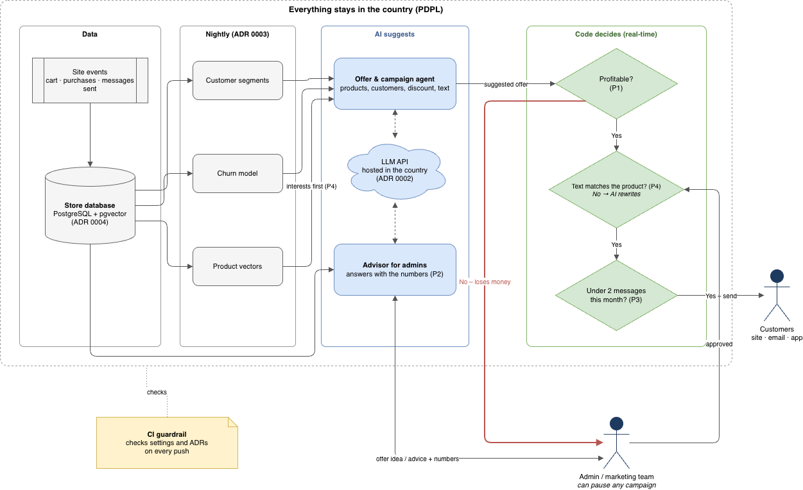

# Governance pack – ShopCo marketing automation

Session 1 mini project.

## Context

ShopCo is an online store whose marketing is done by hand: the same offers for everyone, discounts added manually, campaigns sent from the admin panel. The target system adds AI that suggests offers, recommends products and prepares campaigns. This page sets the rules that system has to follow. Scenario: [README](../README.md).

## Business goals

Measured from launch. Starting numbers are estimates, to be measured just before launch.

| # | Goal | From | To | Within |
|---|---|---|---|---|
| G1 | Customer satisfaction from product ratings | 60% | 80% | 3 months |
| G2 | Sales per month | 100 | 300 | 6 months |
| G3 | New customers who buy again | 4% | 10% | 3 months |
| G4 | Products sold at a loss in offers | 5 of 80 | 0 | 3 months |

- G2 is a stretch goal: offers that fit each customer instead of one offer for everyone.
- G4 can be zero because it's our decision, not customer behaviour.
- Non-goals: fewer returns; faster delivery (outside what a marketing system controls).

## Architecture principles

The AI suggests. Code and people decide.

| # | Principle | Goal | In practice |
|---|---|---|---|
| P1 | **Every offer is checked for profit before it goes live.** Profitable offers go out automatically; offers that lose money go to an admin. | G4 | The AI suggests products, customer group, discount type and size. Code reads cost and selling price and works out the profit per product. Losing offers wait for an admin to approve or reject. |
| P2 | **Every prediction or advice from the AI is based on store data and shows the numbers behind it.** If there isn't enough data, it says so instead of guessing. | G2 | The admin describes an offer idea. The AI reads visits, purchases, clicks, time on page, items removed from the cart (and why, when the customer says), ratings by type (delivery, price, quality), profit and stock, and answers with the numbers it used. The admin decides. |
| P3 | **Every customer has a monthly limit on messages across all channels.** Code blocks anything above it, even if the AI suggested it. | G3 | Limit: 2 messages a month. Code counts what each customer received and stops the rest. |
| P4 | **Recommendations start from what the customer is interested in,** then discount and stock. Any text or image the AI writes must match the real product. | G1 | The AI doesn't push a product to everyone because it's discounted or overstocked. Offer text is checked against the product's own photo and description before it goes out. |

## ADRs

*(to write: three decisions, one file each in `adr/`)*

## ARB checklist

### Security

### Privacy (PDPL)

### Evals

### Cost

### Human oversight

## Automated guardrail (optional)

## Diagram

Source: `../diagrams/src/governance.drawio`
